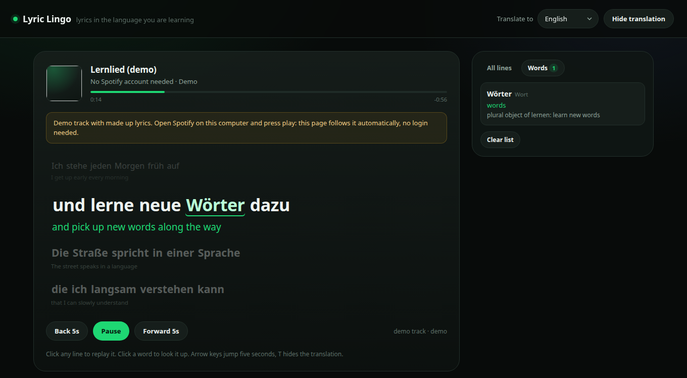

# Lyric Lingo

Follows whatever the Spotify app on this computer is playing and shows the lyric
line that is playing right now, next to a translation into the language you are
learning. Click any line to hear it again, click a word to look it up.

## Why this is a companion app and not a Spotify plugin

Spotify closed its in-client app platform in 2018. There is no supported way to
add a panel inside the Spotify window, and third-party clients are not allowed.
So this runs as a local web page next to Spotify:

- Spotify desktop app plays the music, as usual.
- This app reads the track and the playback position from the app over MPRIS
  (D-Bus), so it needs no login, no API key and no Premium.
- Lyrics come from LRCLIB, which supplies time-stamped (LRC) lyrics.
- Translations come from DeepSeek, one call per song, cached on disk.

## Requirements

- Linux with a desktop session (MPRIS is how the player is read)
- Spotify desktop app, installed as deb, snap or Flatpak
- `playerctl` (`sudo apt install playerctl`)
- Node 20 or newer
- A DeepSeek API key for the translations (optional, the lyrics still work)

## Setup

    git clone https://github.com/justbasicfacts/lyric-lingo.git
    cd lyric-lingo
    cp .env.example .env      # then fill in DEEPSEEK_API_KEY
    node server/index.mjs

Open http://127.0.0.1:8899 and press play in Spotify.

## Using it

- The big line is what you are hearing, the smaller green line is its translation.
- Click any line in the karaoke view or the "All lines" list to jump there and
  hear it again. This seeks the actual Spotify playback.
- Pause, Play, Back 5s and Forward 5s drive the real player, not a local
  simulation. The music in Spotify stops when you press Pause. This works
  without Spotify Premium because it goes through the local app.
- Click a word to get its dictionary form and meaning. Words collect under the
  "Words" tab and stay there between visits (local storage).
- "Hide translation" (or the T key) hides the translations so you can test
  yourself. Arrow keys jump five seconds, space pauses.
- "Translate to" changes the target language. Every language is cached per song,
  so switching back is instant and free.
- No Spotify running? Open http://127.0.0.1:8899/?demo=1 for a demo track with
  made up lyrics, or /?preview=Sonne&artist=Rammstein to look up any song by name.

## Configuration

`.env` keys, all optional except the DeepSeek one for translations:

| Key | Meaning |
| --- | --- |
| `DEEPSEEK_API_KEY` | Key for translations. Without it only original lyrics appear. |
| `DEEPSEEK_BASE_URL` | Defaults to `https://api.deepseek.com`. |
| `DEEPSEEK_MODEL` | Defaults to `deepseek-chat`. |
| `PORT` | Defaults to `8899`. |
| `DEFAULT_TARGET_LANG` | Defaults to `English`. |
| `MPRIS_PLAYERS` | Comma separated player names to look for. Defaults to `spotify`. |

Spotify's Web API is supported as a fallback, for the case where music plays on
another device (phone, another computer) and nothing is playing locally. Those
keys are `SPOTIFY_CLIENT_ID`, `SPOTIFY_CLIENT_SECRET` and
`SPOTIFY_REDIRECT_URI`. The redirect URI must be registered in the Spotify app
dashboard, and the account needs to be one of the app's allowed users. When the
local app is playing, MPRIS is used and the Web API is never touched. The
"Connect Spotify" button only shows up when those keys are set.

## Optional: start it with the session

    mkdir -p ~/.config/systemd/user
    cp systemd/lyric-lingo.service ~/.config/systemd/user/
    systemctl --user daemon-reload
    systemctl --user enable --now lyric-lingo.service

## Files

    server/index.mjs     HTTP server, routes, page compilation
    server/player.mjs    MPRIS reader and transport controls (playerctl)
    server/lyrics.mjs    LRCLIB lookup, LRC parsing, plain lyric fallback
    server/translate.mjs DeepSeek translation, disk cache
    server/auth.mjs      optional Spotify Web API OAuth (PKCE)
    public/              the page: index.html, app.js, styles.css
    data/                caches: lyrics, translations, tokens (not in git)

## Notes and limits

- Word timing is line timing: a line lights up when it starts, it does not fill
  word by word. LRCLIB has word level timing for some tracks, and the parser
  strips those inline stamps, so the app can use them later.
- If LRCLIB has no time stamps for a song, the plain lyrics are spread evenly
  over the track length and marked with a small tilde, so treat those timings as
  approximate.
- Translation is machine output. It is good for meaning, not for poetry.
- The LRCLIB and DeepSeek calls happen on first play of a song; after that the
  answer comes from `data/`.
- Linux only for now. The player is read over MPRIS, which Windows and macOS do
  not have. A port would need a different now-playing source.

## If it does not work

- "The Spotify app is not running on this computer": start the desktop app.
  The web player in a browser does not publish MPRIS, so it cannot be followed.
- The page shows "Lernlied (demo)": that is the demo fallback. The transport
  buttons then only move the demo page, they cannot touch real playback.
- The music does not stop when you press Pause: check
  `playerctl -p spotify status` in a terminal. If it says no players found, the
  app is closed or its D-Bus interface is sandboxed away; `playerctl -l` lists
  what is visible.
- The page looks old after a change: the small build id next to the title shows
  what the browser actually runs. It reloads itself when the server reports a
  newer build.

## License

MIT, see [LICENSE](LICENSE).
